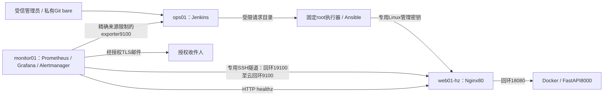

# 架构、节点与权限

本项目是三节点、单实例的Linux运维实践。使用逻辑主机名描述拓扑，实际地址、密钥和来源限制由管理员在私有配置中填写。

| 节点 | 职责 | 管理和采集边界 |
|---|---|---|
| ops01 | Git、Jenkins、Ansible及固定发布执行器 | Jenkins8080和只读Git19418回环监听；exporter9100只允许监控节点精确来源 |
| web01-hz | Nginx、Docker应用、node_exporter | HTTP80入口；应用18080和exporter9100仅回环；管理使用既定私网SSH |
| monitor01 | 采集、HTTP探测、图表、告警 | 3000/9090/9093/9100/9115/19100回环监听；不启用Alertmanager集群端口9094 |

实测环境：CentOS Stream10/x86_64，ops01为4vCPU/3GiB/60GiB，monitor01为2vCPU/2GiB/30GiB。Windows约16GB宿主运行两台本地VM。资源限制属于该学习环境的条件，不代表生产容量；历史构建窗口宿主可用内存曾低于3GiB参考线。

| 组件 | 验收版本 | 锁定位置 |
|---|---|---|
| Docker / Compose | 29.9.2 / 5.6.1 | ansible/roles/project_docker/ |
| Nginx | 1.26.3（CentOS RPM） | ansible/roles/project_nginx/ |
| Ansible core | 2.20.10 | ansible/requirements-control.txt |
| Jenkins | 2.580.2 / Java21 / 32插件 | jenkins/core.lock.json、plugins.lock.json |
| Prometheus / Grafana / blackbox | 3.13.5 / 13.3.0 / 0.29.1 | monitoring/stack.lock.json |
| Alertmanager / node_exporter | 0.34.2 / 1.12.1 | monitoring/alertmanager/lock.json、node-exporter.lock.json |

Jenkins无sudo/wheel/docker权限，不持目标管理密钥，只写受约束的发布请求。root执行器验证请求及可信main完整SHA，再从root所有的工作副本调用Ansible；不执行Jenkins工作区中的任意路径。**能推送可信main的人仍具有高权限发布能力**，不能把不可信PR、任意外部仓库或自由SHA入口接入这条链路。

应用按不可变镜像ID运行，使用非root、只读根文件系统、drop capabilities、no-new-privileges、256MiB/0.5CPU/100PID及日志轮转。构建使用固定基础镜像digest、14个按SHA256校验的Linux wheel和禁联网的Docker构建；首次准备镜像和依赖仍需要可信来源或已经校验的缓存。

监控30秒采样；Prometheus保留7天或2GB，先到达的限制生效。实例切换可能中断，当前实现没有高可用或零停机保证。
